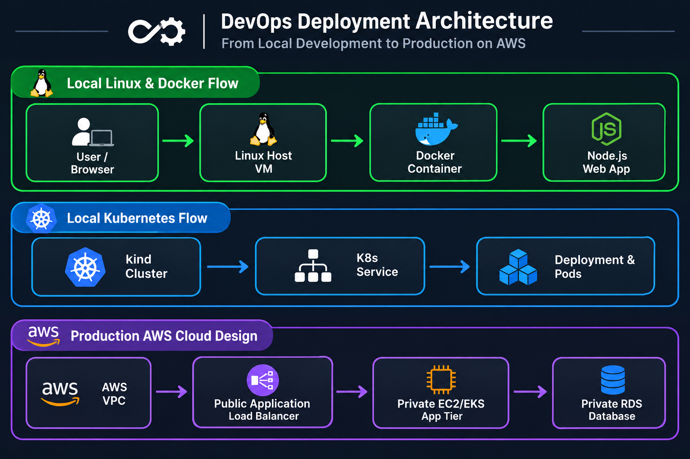

# 🚀 DevOps Winter Arc — Master Revision & Integration Portfolio

## 🎯 Project Overview
This repository serves as the centralized production-ready portfolio for the 7-day intense revision and integration track of the DevOps Winter Arc. The core objective is to showcase the end-to-end delivery path of a microservices application—progressing from basic Linux processes up to containerized layers, local orchestrations, and enterprise-grade secure AWS landing zones.

## 📁 Repository Structure
```text
.
├── README.md                      # Master Revision Portfolio (This File)
├── app/                           # Core Node.js / Express Web Application
├── screenshots/                   # Artifact Proofs & Engineering Diagrams
│   ├── architecture.png           # Target 3-Tier Production Cloud Blueprint
│   ├── security-group-matrix.png  # Firewall Rules Execution
│   ├── iam-role-design.png        # Least-Privilege Verification
│   ├── monitoring-plan.png        # CloudWatch Metrics Mapping
│   └── incident-recovery.png      # Day 36 Break/Fix Evidence
└── docs/                          # Extra Detailed Logs and Trackers
    ├── day31-linux-lab.md         # Process Management & Networking
    ├── day32-docker-lab.md        # Immutable Image Packaging
    ├── day33-docker-compose-lab.md # Multi-Container Architecture Local Setups
    ├── day34-aws-auth-lab.md      # Identity Governance Rules
    ├── day35-aws-architecture-lab.md # Secure Multi-AZ Architectural Design
    ├── day36-integration-lab.md   # Incident Management Report
    └── revision-tracker.md        # Metric Logs and Deliverables Matrix
```

---

## 🗺️ Project Architecture Roadmap
The architecture reflects a secure production strategy across standard infrastructure abstraction layers:



### 📡 End-to-End Request Flow & Network Boundaries
1. **Edge Routing:** Public client requests hit **AWS Route 53** and are passed to an Internet-facing **Application Load Balancer (ALB)** sitting across multiple public subnets.
2. **Compute Isolation:** Traffic is selectively routed over Port `8080` only into completely isolated **Private Subnets** where the application workload runs inside an EC2 Auto Scaling Group or EKS Cluster Pods.
3. **Data Tier Security:** The application queries a private **PostgreSQL Database** over Port `5432`. The database has no public IP or direct ingress from the internet.
4. **Admin Access:** All legacy SSH Port 22 avenues are blocked, using encrypted **AWS Systems Manager (SSM) Session Manager** channels instead.

---

## 📅 Day-Wise Revision Tracks Execution

### 💻 [Day 31] Linux & Port Management
* Analyzed listening ports (`ss -tulpn`) and bound background runtime workflows to predictable localized sockets.
* Evaluated standard system journal logs (`journalctl`) and created isolated custom system users to remove privilege overheads.

### 📦 [Day 32] Docker & Container Optimization
* Engineered optimized multi-stage `Dockerfile` layers to minimize container image overhead.
* Set up strict runtime layer segregation and container isolation rules.

### 🔀 [Day 33] Docker Compose Orchestration
* Created a multi-container stack managing isolated custom application bridges (`bridge network`).
* Integrated a persistent storage volume backing the PostgreSQL service layer to guarantee no data loss on container recreation.

### 🔑 [Day 34] AWS IAM Identity Governance
* Documented granular JSON permissions enforcing the **Principle of Least Privilege**.
* Assigned short-lived IAM roles for service accounts (IRSA) to remove hardcoded long-term keys from the codebase.

### ☁️ [Day 35] Resilient AWS Production Blueprint
* Designed a design-only highly resilient architecture with cross-zone replication.
* Configured automated scaling limits, target boundaries, and health check monitoring probes.

### 🛠️ [Day 36] Controlled Break/Fix & Incident Management
* Simulated a local service crash by intentionally terminating the primary application container backend.
* **Incident Metrics Captured:**
  * **Symptom:** API calls failed instantly with `ERR_CONNECTION_REFUSED`.
  * **Root Cause Identification:** Terminal execution of `docker ps -a` exposed state code `Exited (137)`.
  * **Remediation Action:** Running `docker start` brought the microservice back online instantly, with automated `/health` tracking confirming full system recovery.

---

## 📊 Final Revision Progress Tracker

| Tech Stack | Skills Covered | Status | Portfolio Proof Link |
| :--- | :--- | :--- | :--- |
| **Linux** | Sockets, Permissions, Logs | **100% Confident** | [Day 31 Log](./docs/day31-linux-lab.md) |
| **Docker** | Multistage Build, Volumes | **100% Confident** | [Day 32 Log](./docs/day32-docker-lab.md) |
| **Compose** | Multi-Container Networks | **100% Confident** | [Day 33 Log](./docs/day33-docker-compose-lab.md) |
| **AWS IAM** | Identity Delegation, IRSA | **100% Confident** | [Day 34 Log](./docs/day34-aws-auth-lab.md) |
| **AWS Cloud**| 3-Tier VPC, ALB, Resiliency | **100% Confident** | [Day 35 Log](./docs/day35-aws-architecture-lab.md) |
| **Incident Ops**| Break/Fix Execution, Monitoring| **100% Confident** | [Day 36 Log](./docs/day36-integration-lab.md) |

---
*Note: The AWS cloud blueprints detailed within this integration run are strictly intended as production-grade structural designs and architectural validation layouts (Design-Only Execution).*

